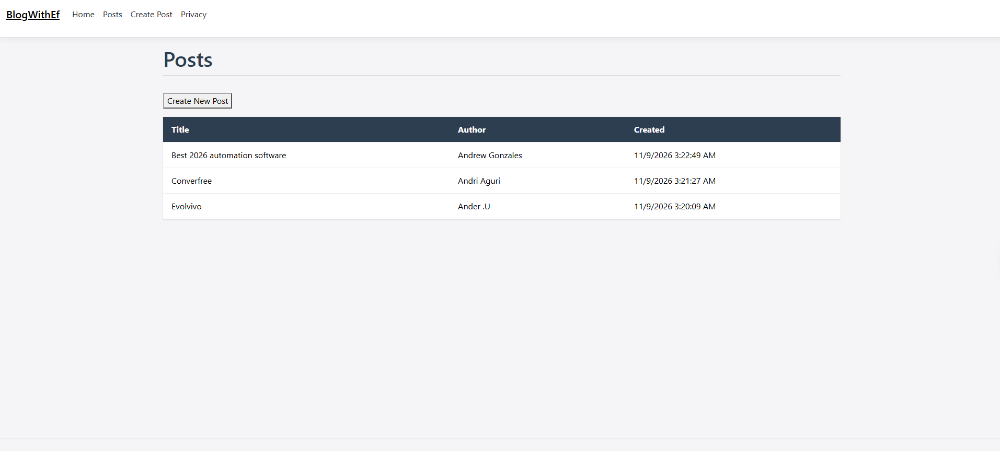

# BlogWithEf

A simple blog application using ASP.NET Core MVC and Entity Framework Core with SQLite.

## How to Run

1. Clone this repository
2. Navigate to the project folder: `cd BlogWithEf`
3. Restore dependencies: `dotnet restore`
4. Apply database migrations: `dotnet ef database update`
5. Run the app: `dotnet run`
6. Navigate to `https://localhost:<port>/Posts` in your browser

## Features
- Create new blog posts (title, body, author)
- View all posts (Index page)
- Data persisted using Entity Framework Core + SQLite

## Screenshot
